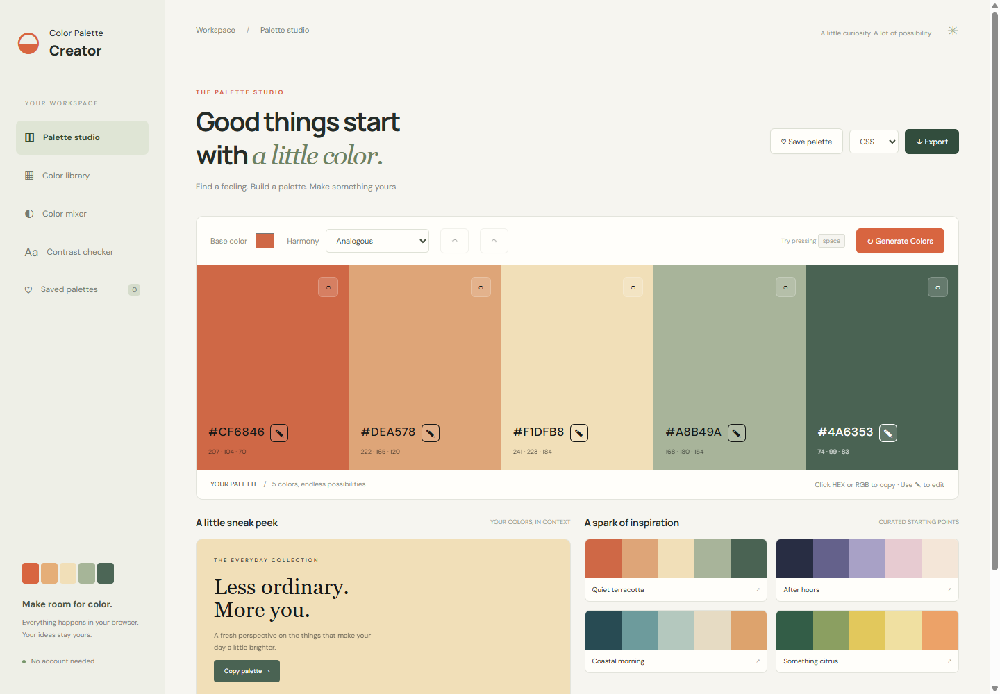

# Color Palette Creator



A responsive, browser-based color workspace. The Vercel app replaces the original Streamlit interface; the original Python source remains available in this repository.

## Features

- Five-color palettes with six harmony modes, individual editing, locks and undo/redo
- Curated starting palettes and a live design preview
- Named-color search and nearest RGB matches for HEX / RGB input
- Local image palette extraction; images stay in the browser
- Normal, multiply and screen color mixing
- WCAG AA / AAA text contrast checks
- Named palettes saved in browser local storage
- CSS variables, JSON, SVG and PNG exports
- Responsive layouts and keyboard support (Space to generate)

## Development

Requires Node.js 22 or newer. No runtime dependencies or API keys.

```sh
npm run dev
npm test
npm run build
```

Open http://127.0.0.1:4173. Vercel runs `npm run build` and serves `dist/`.

Saved palettes belong to the current browser and device. Export them for a portable backup. Image extraction chooses frequent quantized RGB colors, and similar-color search ranks RGB distance. Contrast checking applies WCAG luminance ratios.

## Original app

`legacy/` preserves `main.py`, `color_srgb.csv`, and the Python dependency files for the previous Streamlit implementation. To run that version, change into `legacy/` first.

## License

MIT. See LICENSE.
